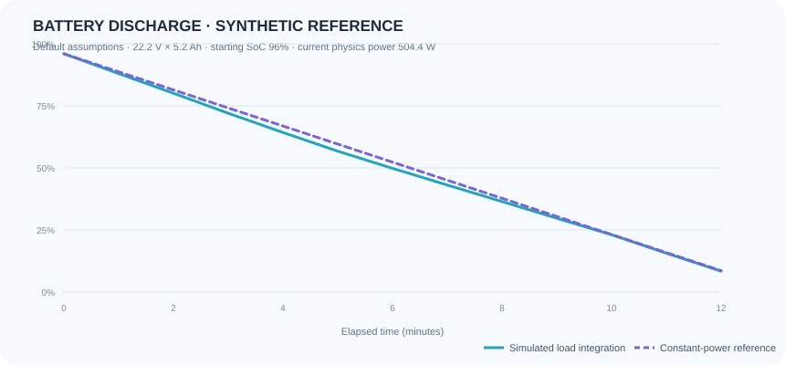

# DRONE-TWIN X

**Physics-informed drone digital twin** · HackFusion 2026 · Theme 3

DRONE-TWIN X is a browser-based mission simulator with a Three.js quadcopter, a multi-waypoint 3D environment, telemetry, environmental and vehicle scenarios, and explainable local safety advice. Use **START SIMULATION** to run the predefined route or a validated manual route. The same simulation state drives the 3D scene, map, risk panel, battery estimates, event history, and charts.

## Demo and validation figure

- **Live demo:** [physics-informed-drone-digital-twin.vercel.app](https://physics-informed-drone-digital-twin.vercel.app)
- The source folder did not include a Git remote URL, so no clone URL is claimed here. This is the local project copy used to build the demo.
- The figure below is a synthetic model comparison generated by this project. It is not a screenshot of flight hardware or measured aircraft data.



## What the app demonstrates

- 3D mission flight with route waypoints, return-to-base routing, wind visualization, and camera modes.
- A route planner with editable and reorderable waypoints, map/3D placement, preflight checks, route estimates, save/load, and JSON import/export.
- Eleven scenario presets and live overrides for wind, direction, turbulence, temperature, payload, battery, speed, motor efficiency, and altitude.
- A local inference layer: physics-based energy estimates plus deterministic safety rules produce risk, confidence, battery reserve, mission feasibility, and a directive with reasons. This is not a trained ML model or a remote backend.
- Live event history, mission summary, telemetry, risk factors, and battery/power/environment charts.
- A visible **simulated vs expected battery discharge** benchmark using a repeatable synthetic load profile and an independent constant-power energy-balance reference.

## Physics and local decision method

The aerodynamic load uses `D = 0.5 × ρ × Cd × A × v_relative²`. The estimated electrical power combines mass-scaled hover demand, drag power, climb load, wind and payload load, motor/rotor efficiency, and degradation. Battery state is updated by integrating power over the simulation clock against the assumed pack capacity. Air density is reduced with altitude using an exponential scale-height approximation.

Risk is a bounded, deterministic score from wind, turbulence, temperature, payload, motor degradation/efficiency, battery reserve, and altitude. The directive prioritizes the return threshold and critical operating limits, then recommends return, reduced speed, altitude change, or continuing. The interface exposes the score, predicted destination/return charge, feasibility, confidence estimate, and reason text. All thresholds and constants are prototype assumptions; they are not certified flight limits.

### Battery benchmark methodology

- Pack assumption: 22.2 V × 5.2 Ah = **115.44 Wh**; start state of charge is the current UI battery value (96% by default).
- Horizon: 12 synthetic one-minute intervals.
- **Expected** curve: constant-power energy balance, `SoC(t) = clamp(SoC₀ − P₀ t / 115.44 Wh × 100, 0, 100)`, where `P₀` is the current local physics model’s power at the selected conditions.
- **Simulated** curve: integrates the same `P₀` with deterministic load variation `1 + 0.08 sin(0.63t) + 0.035 cos(0.31t)` per minute. This tests integration, direction, bounds, and response to changing load against a simple analytical reference.
- At the default initial conditions the reference power is about **504.4 W**; synthetic discharge comparison MAE is **1.04 percentage points** and RMSE is **1.39 points** over 13 plotted points. Changing the scenario changes these values.
- This is a synthetic/reference check of the model implementation, not validation against a real drone, flight log, battery datasheet curve, or independent sensor data. The forecast-vs-simulation energy chart also compares the one-step model estimate with integrated simulator energy, not real telemetry.

## Scenarios

Normal Mission · Strong Wind · Heavy Turbulence · High Temperature · Low Battery · Heavy Payload · Motor Degradation · Combined Failure · **Heavy Payload + Microburst** · **Degraded Motor** · **Hot / Low-Density Air**.

The Hackathon Demo control starts the route and injects a synthetic crosswind/turbulence/battery event during flight. Choose **START SIMULATION** for a normal preflight-checked run; unsafe or infeasible routes are blocked with the failed checks shown in the decision panel and event log.

## Architecture

```text
React dashboard and mission controls ─┐
React Three Fiber 3D scene ────────────┼── Zustand shared simulation state
Maps, charts, telemetry and event log ─┘             │
                                  local physics + benchmark + risk/decision rules
                                                     │
                          documented future API contract: /predict, /telemetry,
                                                   /decision, /mission-state
```

- `src/simulation/model.js` — physics estimates, mission metrics, preflight validation, safety directives, and scenario presets.
- `src/simulation/store.js` — simulation clock, vehicle motion, integrated energy, events, and mission lifecycle.
- `src/simulation/benchmark.js` — repeatable synthetic battery benchmark and error metrics.
- `src/simulation/api.js` — feature payload and local inference adapter; no backend or trained model is connected.
- `src/3d/Scene.jsx` — existing GLB environment and animated drone.
- `src/App.jsx`, `src/MissionPlanner.jsx`, and `src/styles.css` — command center, controls, planner, benchmark and presentation.

## Setup and commands

Requirements: Node.js 20+ and npm.

```bash
npm install
npm run dev
npm test
npm run build
npm run preview
```

The 3D models are served from relative URLs under `public/models`. OpenStreetMap tiles require an internet connection in map view. Map coordinates are demonstration coordinates anchored near Tirupati, India; they are derived from the local simulation and are not live GPS.

## Tests and current validation evidence

Run `npm test` for the built-in Node test suite. It covers power/battery arithmetic, drag response, altitude density trend, battery benchmark bounds and determinism, scenario values, preflight safety blocks, low-battery return advice, and that starting the simulation advances the drone position. Current suite: **14 passing, 0 failing**. `npm run build` produces the Vite production bundle.

## Limitations

- No trained ML model, backend service, real aircraft telemetry, or measured validation dataset is included.
- The benchmark is deterministic synthetic data and only checks consistency with a simplified energy-balance reference.
- Vehicle, battery, aerodynamics, wind, and safety thresholds are simplified assumptions for a hackathon demonstration.
- The app is decision-support simulation software, not flight-control, certification, or safety-critical equipment. The optional telemetry adapter is read-only. Do not use its recommendations to operate a real aircraft.

## Restored command-center features

The local project includes direct **Power On**, **Takeoff**, **Move Forward**, **Stop / Hold**, and **Return to Base** commands; the original start/pause/restart simulation flow; evaluation and model status panels; a browser speech voice-copilot control; and an explainable energy and risk-factor breakdown. The direct return command marks a live route to base, and hold pauses movement while retaining position. These controls use the same local simulator state as the 3D world, map, radar, telemetry, scenarios, planner, and benchmark charts.

## Digital-twin intelligence upgrades

- **Real-time twin panel:** displays battery state, voltage/current, local GPS, altitude, speed, estimated/received motor RPM and temperature, wind, payload, and component-health indicators. Values come from the simulation unless a user connects a configured HTTP JSON feed; the panel labels the source.
- **Physics + telemetry fusion:** a healthy reference motor-temperature estimate is compared with observed or synthetic motor temperature. A simple explainable residual/vibration rule estimates anomaly risk and lists the signal, confidence score, and advisory. This is a transparent heuristic, not a trained AI or validated failure predictor.
- **Predictive fault cards:** motor/bearing, battery, and navigation risk use explicit prototype thresholds and reasons. Failure-injection buttons simulate motor failure, battery degradation, GPS loss, high wind, sensor failure, propeller damage, and payload increase. Injection is simulation-only and reversible.
- **What-if lab:** changes wind, payload, battery, temperature, and route scale in a candidate mission. The Run button calculates landing reserve, risk, energy, duration, and advisory against the state captured when the panel was opened. Apply transfers the candidate into the local twin.
- **Route risk profile:** computes a modeled risk and reserve estimate at every mission waypoint. A conservative lower-speed/lower-altitude profile is shown for comparison. **REROUTE PLAN** uses a nearest-waypoint distance heuristic on the editable plan; review its risk profile and preflight report before starting.
- **Safety response:** simulation recommendations include continue, slow down, return to base, mission abort, and controlled vertical emergency landing. The emergency landing and all injected events are simulated. They never send flight-controller commands.
- **Software-only telemetry:** the local flight simulator generates changing position, attitude, battery, and sensor readings. No hardware, account, or paid service is needed.

### Telemetry data boundaries

The default view is deterministic synthetic telemetry generated from the same twin state. GPS coordinates are projected from the demonstration origin documented above. Motor temperature, RPM, vibration, and component health are model estimates unless a connected endpoint supplies the respective fields. The failure engine is a heuristic prototype. Battery degradation adjusts modeled pack capacity; the user can inject it for a repeatable demonstration.


## Arduino UNO / Tinkercad bridge

The dashboard includes a moving [software flight simulator](/esp32-simulator) and a [sample input page](/arduino-bridge). Both run in the browser and need no hardware. The sample page accepts a manually entered seven-field example line (`ALT, ACC, PITCH, ROLL, YAW, THR, BAT`) to demonstrate how sensor-shaped readings affect the twin.

All telemetry in the current app is generated locally or manually entered as a sample. The sample input does not read USB devices or connect to a drone. Values such as voltage, current, motor temperature, and RPM are estimates.
